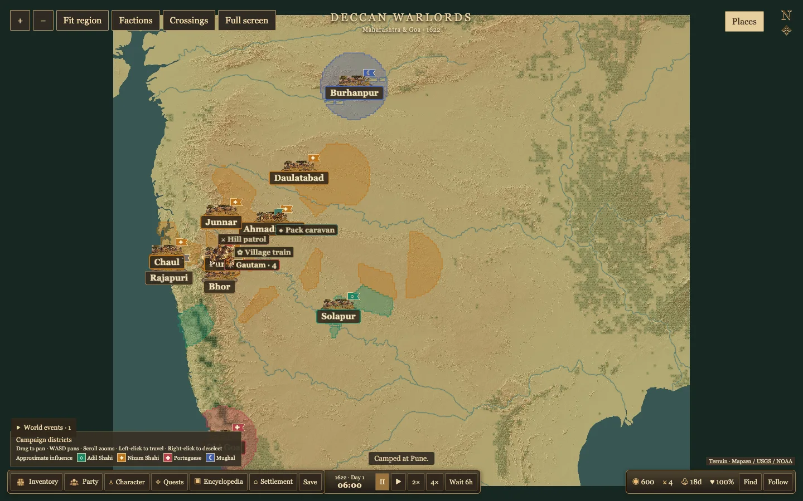

# Market availability, rations and map clarity

Small local sellers replenish up to roughly one ninth of the market's target per day until the retail reserve is reached. Background food demand uses one thirtieth of the target per day. Caravans buy at most 16 units per stop and preserve a third of the target stock for local buyers. Player trade can still draw down a shop, and the existing weekly pricing and shortage response remain in effect.

Healthy companies use one ration per 12 person-days. Gautam and three guards spend one ration every three days. The six starting rations therefore cover about 18 days at full health. Food shortages reduce health by eight points when a ration is due. Wounded companies can spend an extra ration per day to recover 20 health. A guard can die only after three consecutive days at zero health and without food. Combat losses still apply independently. Saved campaigns retain their stores and health.

The faction layer distinguishes Adil Shahi, Nizam Shahi, Portuguese and Mughal holdings with a color and symbol. Shaded outlines indicate approximate local influence around catalogued locations. These are gameplay graphics based on recorded control or sovereignty. Sparse and unknown areas stay uncolored, and the symbols are map identifiers. The Factions button toggles shading. Towns render larger at closer zooms and smaller on the regional overview.

Dense forest cores on steep Ghats cells use the existing modern terrain proxy. They appear darker and block movement. The existing mountain and river barriers still apply. The new forest mask excludes settlement and crossing cells. Restored parties reroute if an earlier path now crosses blocked ground.

Trade, recruitment and relevant campaign events produce transient notices at the top center. The HUD shows estimated days of food at full health.

Chrome verified the faction layer, trade notice, and the three-day ration cadence. The build and 50 tests passed. The data validator reported zero errors and the two existing Panhala warnings.

