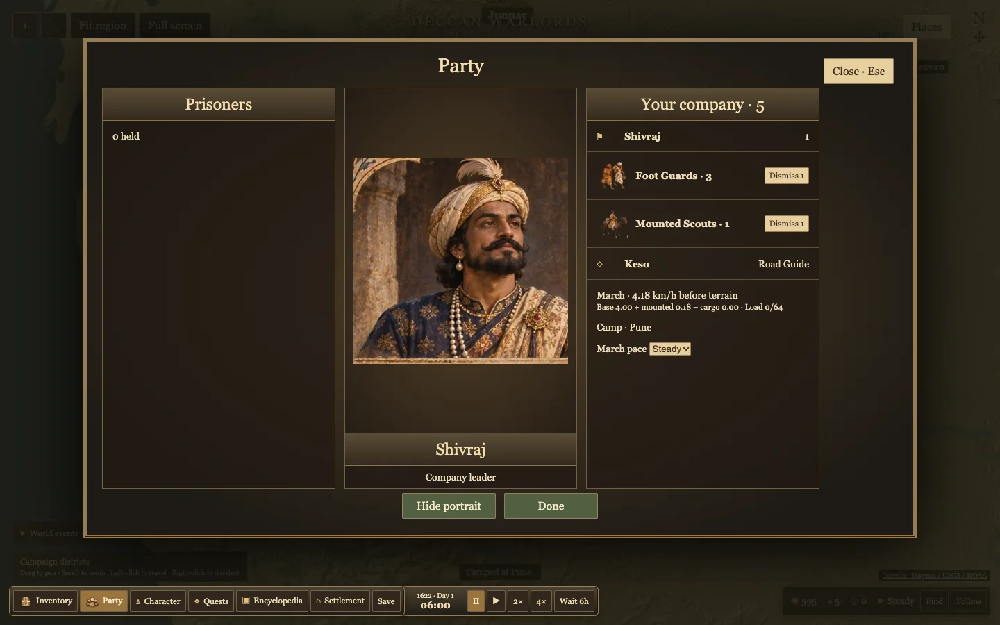

# Company and settlement services

The Party and Inventory screens use the player portrait as a center column that can be hidden. Party shows separate foot and mounted rows, named companions and prisoners. Inventory and the market share custom grain and wood icons. Settlement panels display larger artwork, historical classification, sovereignty and local control from the catalog.

Donaje, Saswad and Bhor have small foot-recruit pools. Pune and Ahmadnagar also offer mounted scouts and meeting houses. Recruitment draws from a finite pool per location in this preview. Keso and Yusuf are fictional named companions. The meeting house is a gameplay label and the companion fees, troop availability and Kondhana prisoner reward are gameplay assumptions. A prisoner taken in the Kondhana encounter can be ransomed at either meeting house. Individual companion portraits and relationship-driven conversations remain future content.

The party screen explains the march budget before terrain. Mounted scouts add speed and capacity. Wood weighs twice as much as grain in the preview formula, and excess cargo reduces the march budget. Old saves without a company ledger get an empty ledger and retain their existing guard count.

Bhor is a draft market town in the catalog. Its fortification and 1622 allegiance are unverified. The later Bhor State is documented separately. [Maharashtra State Gazetteer](https://gazetteers.maharashtra.gov.in/cultural.maharashtra.gov.in/english/gazetteer/Poona/PART%20VI/Chap%20%2820%29/Banesvara.htm)

Chrome verified recruitment and payment, hiring, dismissal, portrait toggling, inventory icons, allegiance and the capture-to-ransom loop. The build and 41 tests passed. Data validation reported zero errors and the two existing Panhala warnings.

