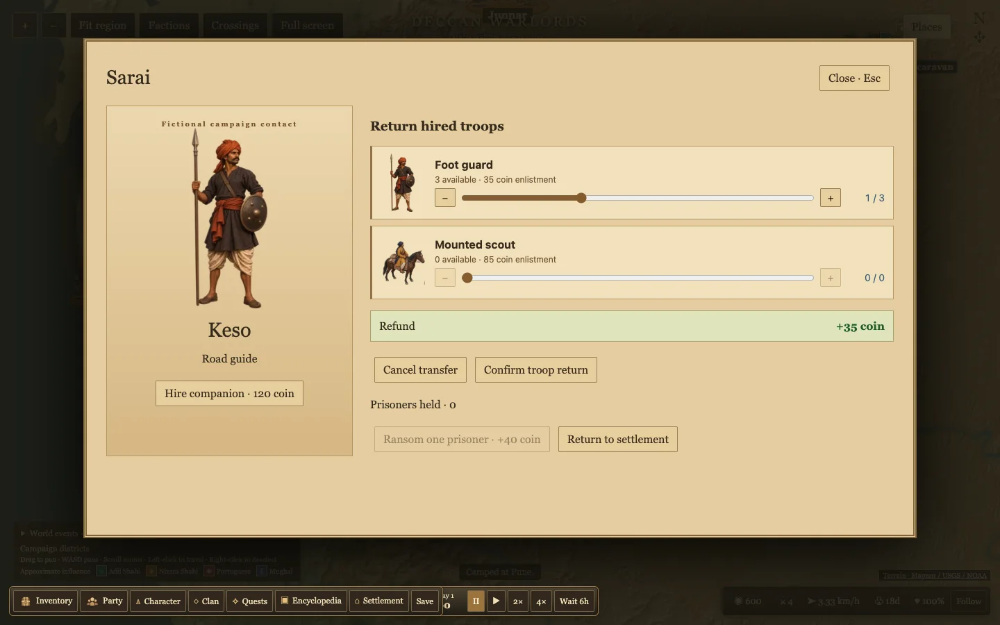
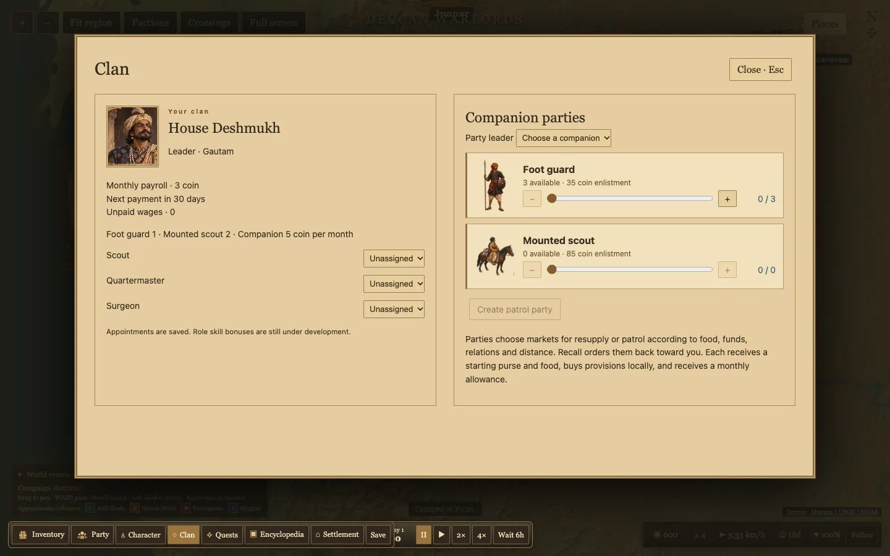

# Sarai and Clan presentation

Troop transfer cards show illustrated foot guards and mounted scouts, availability, enlistment fee, a slider, plus/minus buttons and an explicit selected/available count. Sarai separates the companion portrait and hiring action from troop returns and prisoners. Refund totals stand apart from the action buttons. Clan uses the same transfer cards, a leader portrait and party leader illustrations. Transfers remain drafts until their existing confirmation actions.

Debit text on pale treasury tooltips now uses dark red (#951e17). The dark HUD uses a brighter red for health warnings. This resolves the prior broad HUD rule that made tooltip deductions pale pink.

The workshop references were reviewed and a concrete first grain-mill design is recorded in WORKSHOP_PLAN.md. Workshop code is still pending. Full video playback and transcripts were unavailable, and community descriptions are treated as design references rather than exact current Bannerlord rules.

Build and 55 tests passed. Data validation reported zero errors and two existing Panhala warnings. Chrome at 1440×900 verified troop art, increment/cancel controls, refund display and the computed dark debit color. Screenshots were visually inspected.

