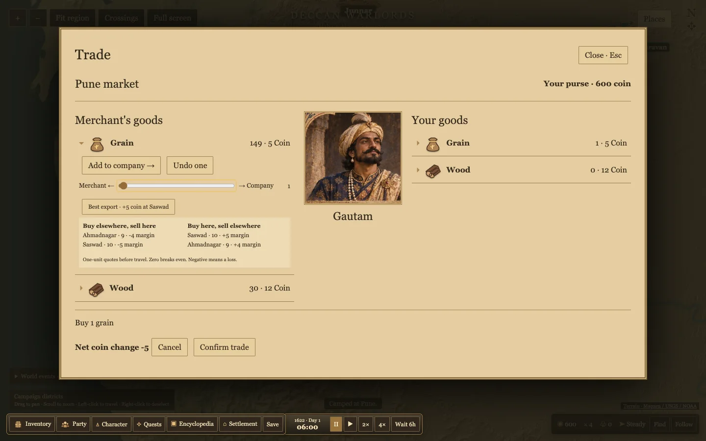

# Market balance and roadside conversations

Buying removes stock and can raise the next unit price. Selling adds stock and can lower the next price. A single stock-based price curve applies in both directions. A sale uses the stock after the returned unit is added, so reversing a purchase immediately refunds exactly what was paid, including an applicable supplier discount.

The preview limits commodity quotes to half through twice the base price before any supplier discount, and each town can hold up to three times its stock target. Towns consume grain once per game day. When the village train reaches Pune from Saswad, it delivers up to 12 grain, capped at Pune's target stock. Player and merchant deliveries use the same market stock. The older Godot prototype also distinguished stock and money, and its design left the price formula open. This implementation uses the existing TypeScript economy.

Drag the transfer slider left to sell or right to buy, review the net coin change, then confirm. The price list shows signed margins for other towns before travel costs, based on one-unit live quotes. Large transfers can change prices along the way. Recruitment also has a quantity slider.

Click the sprite or the banner of a nearby party to open a roadside scene. The pack caravan can trade from there. The scene uses existing art and a subtle CSS idle loop. The meeting house shows illustrative role art for the named companions. New campaigns default to Gautam. Existing saves retain their chosen names.

The build and 45 tests passed. Data validation reported zero errors and two existing Panhala warnings. Chrome verified market sliders, draft confirmation and cancellation, and clicking a nearby caravan to open dialogue and trade.

