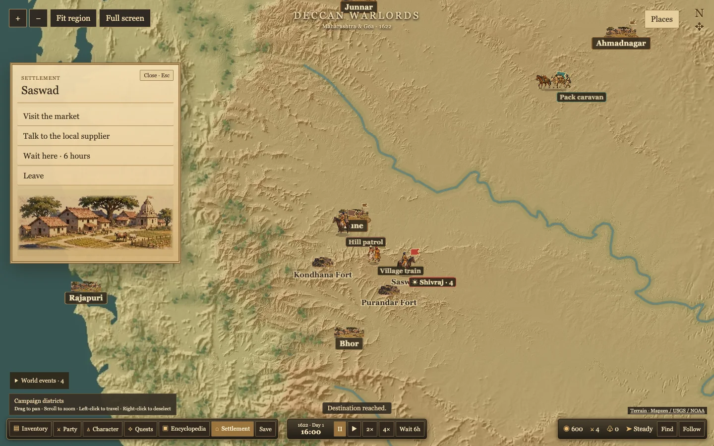

# Campaign movement and map presentation

Open the local campaign with `npm run dev` at `http://127.0.0.1:5173/`. Click open ground to travel, a settlement to visit, or a party's banner to inspect it. Drag to pan and use the wheel to zoom. Right-click clears inspection while the current order continues. The bottom HUD has pause, 1×, 2×, 4×, a six-hour wait and controls to find or follow the player.

The simulation worker advances fixed game hours. The map plays the completed travel segments in sequence, including turns taken within a tick. It retains the current visual position when paused and changes playback rate without restarting a segment. Arrival actions open when the rider reaches the settlement on screen. Travel does not draw a line on the map.

The terrain planner avoids blocked cells, preserves less costly bends and rounds turns where there is clearance. When a historical pin falls in a blocked cell, gameplay uses the nearest walkable approach. The map continues to show the original pin. Crossing locations and woodland remain provisional gameplay geography.

The existing map relief now has a separate static vegetation and river layer. Parties turn, sway, kick up light dust and carry waving flags. The player and patrol use rider art, with separate sprites for the caravan and villagers. Inventory and Party use a central portrait and side lists. This build uses 2D sprite animation.

## Verification

Chrome at 1440×900 verified off-settlement orders, pausing the player and NPCs mid-step, resuming at 2× and 4×, dragging out of Follow, right-click without cancelling a move, a timed wait, rerouting toward Ahmadnagar, and Saswad arrival, market, Inventory and Party. In a 90-frame hardware-accelerated follow sample at 4×, the median frame interval was 16.7 ms and the 95th percentile was 16.8 ms. Software WebGL ran slower.

`npm test` passed 39 tests. `npm run validate-data` reported zero errors and the two existing Panhala region warnings. `npm run build` passed with the existing large-bundle advisory.

## Sprite provenance

The built-in imagegen tool produced both fictional sprites. The game uses trimmed, resized, right-facing WebP exports with alpha.

- [Campaign caravan](../../apps/game/public/art/campaign-caravan.webp). Prompt — Use case: stylized-concept. A single transparent cutout game sprite for Deccan Warlords, an illustrated 1622 western Deccan campaign map. One small loaded pack caravan of a lead brown horse and a tan pack bullock carrying bundled trade goods, with one walking handler beside it in simple regional clothing. Side three-quarter overhead strategy-map angle, heading to the left, a single compact silhouette readable at 50 pixels. Full bodies and hooves visible, warmly lit painterly realism with dark outlines, muted teal, tan and ochre. Transparent background; no scenery, ground plane, cast shadow, border, text or flag. Art is a fictional gameplay depiction.
- [Village traders](../../apps/game/public/art/campaign-villagers.webp). Prompt — Use case: stylized-concept. A single transparent cutout game sprite for Deccan Warlords, an illustrated 1622 western Deccan campaign map. Two fictional Deccan village traders on foot, each carrying a small basket or bundle, with one wearing an undyed cotton wrap and the other a muted ochre garment. Side three-quarter overhead strategy-map angle, heading to the left, two close figures in a single compact silhouette readable at 40 pixels. Full bodies and feet visible, warm light and painterly realism with dark outlines. Transparent background; no scenery, ground plane, cast shadow, border, text or flag.
