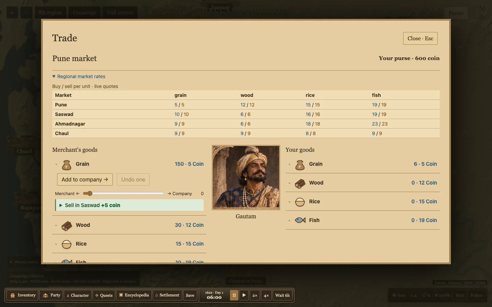

# Regional supply and map interaction

The regional ledger shows live unit buy and sell quotes for four markets. A trade item only suggests destinations that can buy the entire selected quantity at a positive gross margin. The three highest qualifying margins appear before travel and future stock changes. Buy and sell drafts still require confirmation.

Market reference stock refreshes each game week. Stock movements within a buffer of 20 percent of target stock leave the quote anchored to the reference. Larger shortages or gluts move the quote immediately. Prices still reverse exactly for an immediate return under identical market conditions. The existing stock cap and budget checks apply to all goods.

Chaul specializes in rice and fish in this preview. Saswad and Ahmadnagar produce grain. Production, local consumption and monsoon output are tunable gameplay values. The Kolaba and Ahmadnagar gazetteers inform the regional pattern without supplying exact 1622 quantities. The village train takes actual stock from Saswad and earns money on delivery to Pune. The merchant compares reachable batch margins per hour using terrain-adjusted effort and moves purchased stock physically.

New companies begin with six grain. Grain, rice and fish can feed the company. Food use depends on roster size. Hunger reduces health and movement, and sustained starvation can kill guards. Mounted troops, cargo and terrain also affect travel. The manual pace switch and empty troop rows are gone.

The companion venue is called a Sarai. This is a gameplay label inspired by travellers' rest houses documented in Mughal India. [IGNOU history material](https://egyankosh.ac.in/bitstream/123456789/82891/3/Theme-5.pdf)

WASD pans. The settlement artwork, selection rings and click targets are larger. Clicking a moving party approaches it and opens dialogue in range. The Crossings overlay shows sample traversable corridors and bridge symbols for provisional crossing cells. Historic bridge sites and a curated alternate-route network remain future work.

The build and 48 tests passed. Data validation reported zero errors and two existing Panhala warnings. Chrome verified panning, regional rates, profitable-only advice, trade confirmation, empty troop rows, the route overlay and automatic dialogue.

