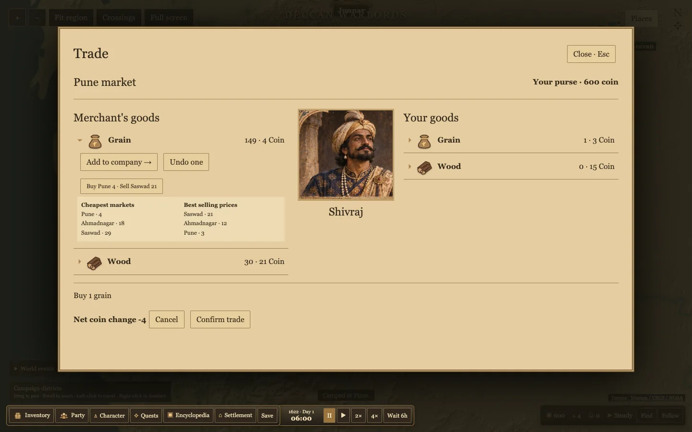

# Trade drafts and campaign encounters

Market and troop rows expand in place. Market arrows stage quantities and preview the net coin change. Cancel discards the draft. Confirm applies the entire basket against the live market, with a fresh quote required if the net changes. Party dismissal also requires confirmation. Inventory rows expose cargo weight.

Price comparisons list up to five cheapest buying markets and five best selling markets. The preview currently has three town markets. Quotes are live one-unit prices, so stocks, quantities and travel can change the eventual profit.

Click a nearby moving party banner to talk or leave. The pack caravan also supports confirmed trades using its actual purse and carried stock. The interaction range is 4 km. Troop and village parties offer short role-specific dialogue. Roadside attacks and protection or taxation are pending.

The map has larger settlement markers and flags on forts. Flags prefer recorded local control, then recorded sovereignty. Grey indicates unknown affiliation. The Crossings toggle displays provisional passable river cells used by the existing terrain grid. Verified period roads, individual bridges, borders, alternate corridor tuning and fort jurisdiction need separate map work.

Chrome verified the price rankings, cancellation and confirmation for market and troop drafts, the crossing toggle, and a roadside conversation and sale to the pack caravan. The build and 43 tests passed. Data validation reported zero errors and two existing Panhala warnings.

## Foot guard artwork

The built-in imagegen tool created the fictional guard. The trimmed WebP is used in Party and Recruitment. [Foot guard sprite](../../apps/game/public/art/foot-guard.webp)

Prompt — Use case: stylized-concept. Single full-body fictional 1622 western Deccan foot guard game sprite, three-quarter view, standing holding a plain spear and small round shield, simple dark cotton tunic and rust turban, period-inspired design, painterly realism with warm ochre light, strong legible silhouette at 48px. Full feet and spear visible, transparent background, no ground, text, flags, scenery or border.
